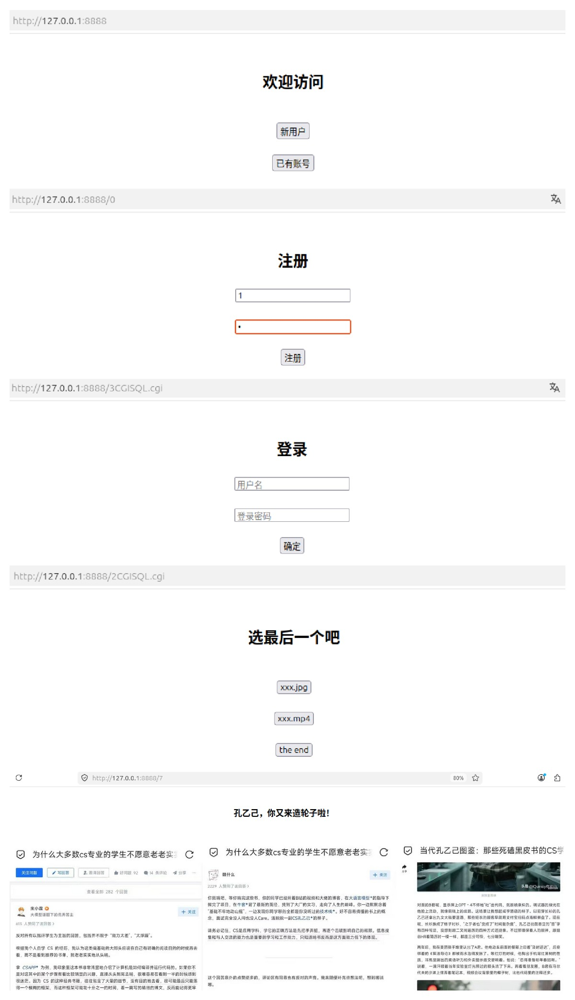
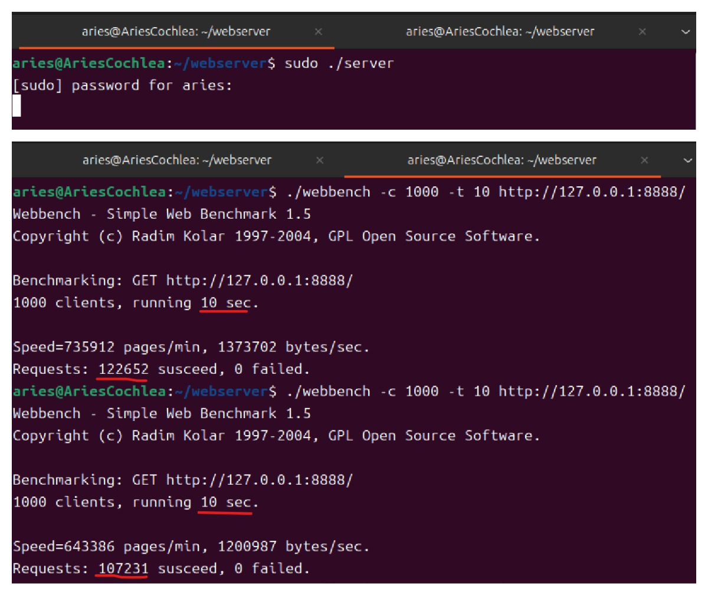
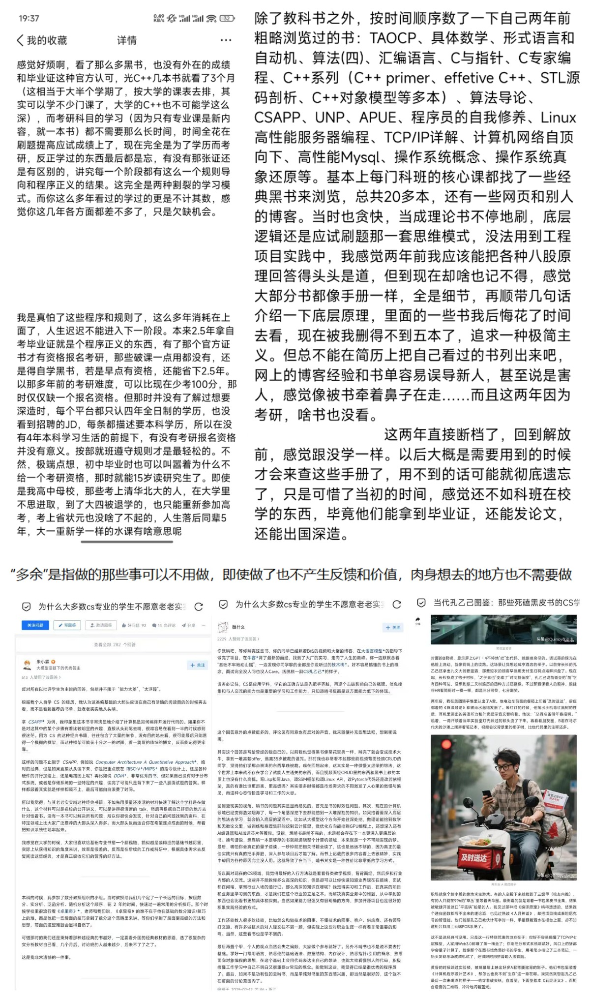
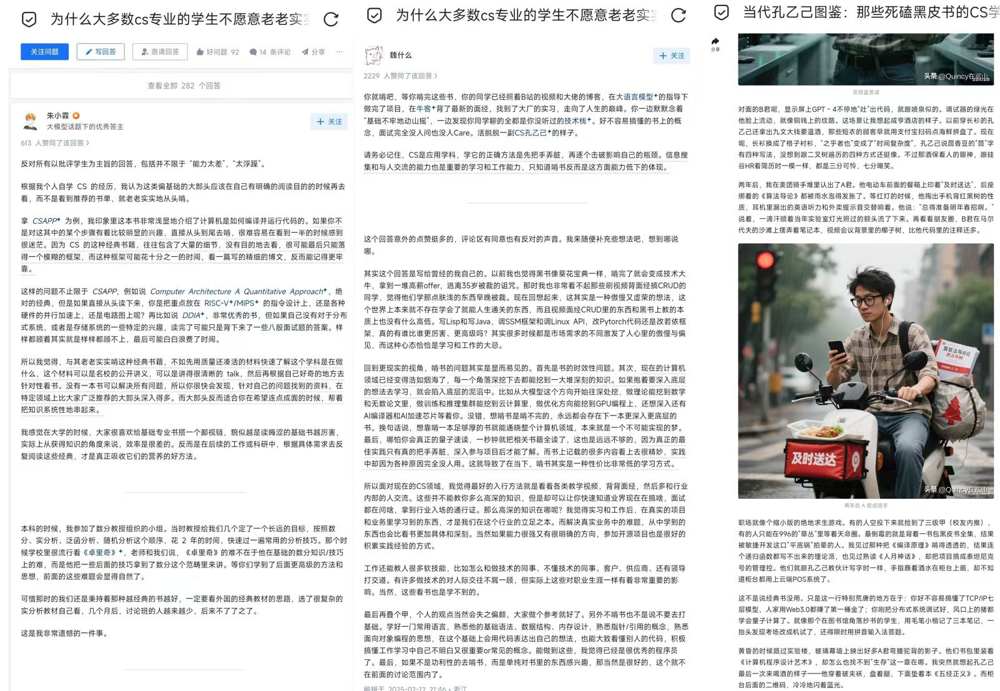
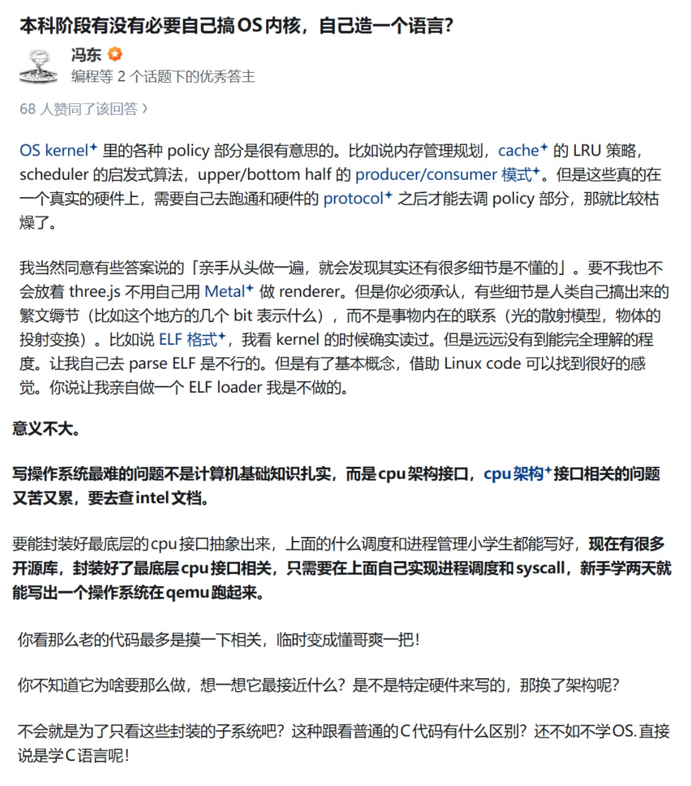

不要重复造轮子。人生苦短，时间流逝太快，世界变化更快。 ——2026年4月于家牢中。 

<br><br>


## 项目说明

原项目完成于2022年6月。现在使用cursor重写了自己Webserver的核心模块（多年前很经典的项目，后来变得烂大街，现在已经彻底过时了，写在简历上反而是减分项），并在虚拟机里的Ubuntu上跑通了，体会到了AI对普通的前后端方向的彻底颠覆。
* Reactor/Proactor  +  epoll（ET/LT） +  非阻塞IO  +  线程池
* 异步日志模块
* 数据库连接池，实现网页端的用户注册、登录功能；网页端可使用HTTP协议向服务器请求图片、视频等文件
* webbench压力测试


## 环境配置
* Linux、C++、MySQL
* 服务器测试环境：
	* Ubuntu 24.04.4 LTS
	* MySQL 8.0.45
* 浏览器测试环境：
	* FireFox，本地回环地址127.0.0.1


## 项目启动
* 下载MySQL后登录
```
	// MySQL 有一种认证方式叫 auth_socket ，它的逻辑是：
	// 如果 MySQL 用户名 = 当前操作系统用户名，且该操作系统用户已登录，则允许直接连接，不需要密码。
	// 本项目只是个简单的玩具轮子（C++已经有很多成熟的网络库了，比如Boost.Asio、libevent等，写到这句的时候觉得以前花在这个项目上的时间实在是太愚蠢了，很多所谓的知识细节和底层原理真的像CS孔乙己一样），
	// 所以mysql没设置密码，直接登录：
	sudo mysql
	create database yourdb;    // 建立yourdb库
	USE yourdb;                // 创建user表
	CREATE TABLE user(
    	username char(50) NULL,
    	passwd char(50) NULL
	)ENGINE=InnoDB;
	//退出mysql
	quit; // 或exit;
```


* 运行
```
	//编译
	make
	//运行
	sudo ./server  //因为数据库用户名和系统管理员同名都是root，所以这里要用sudo
	//项目文件复制到Linux上可能遇到无法访问的问题，浏览器或日志会报错:You do not have permission to get file from this server.
	//则需要修改./file目录下文件的读取权限：
	chmod 644 ./file/*.html ./file/*.ico ./file/*.jpg ./file/*.mp4 ./file/*.png ./file/*.gif
	//再重新运行
	sudo ./server

	//等待几秒后，在本地Ubuntu浏览器地址中输入：
	http://127.0.0.1:8888/    //即可访问
```


## 效果演示

<div>
  
</div>


## 压力测试
```
	// -c表示客户端数，-t表示时间， QPS = 总请求数 / 总时间，即每秒可达到上万的并发连接（不同环境运行结果波动较大）
	// 运行服务器sudo ./server的同时再运行：
	./webbench -c 1000 -t 10 http://127.0.0.1:8888/    //我本人电脑的用户数量-c设置为10000会造成资源不足的错误，改成1000了
```
<div>
  
</div>


<br><br>
<br><br>
<br><br>
<br><br>
<br><br>

### 后记：
应该没多少人会看到这里，所以在这个隐蔽的地方再写点东西。我在用AI重做这些玩具轮子的时候，特别想快点结束，对项目所涉及的知识原理和底层细节也不像当初刚接触时那么在意，反而觉得枯燥和鸡肋，失去了耐心和兴趣，在学生时代就不喜欢复习旧东西，现在更多的心态像是在完成旧时代的几件未竟之事，跑通后再也不想碰它们，毫无成就感，然后现在特别想去迎接AI的新时代，继续学AI知识，做AI项目。计算机这种层层抽象的人造规则系统，向下层探索时应该适可而止，不然一辈子都不够你耗的。很多底层原理细节都是一些人造规则、人造知识、人造手册等繁文缛节，AI时代应该拒绝当CS孔乙己。以前初入编程，喜欢像学数学一样把每个角落每个细节都搞懂，与其刨根问底，不如多去探索一下技术（当成一种工具）的能力边界，如无必要勿造轮子，而是把精力放在真正需要人去参与解决的关键问题上。IT行业中重复造轮子就是明知道你做的不可能比前辈做得更好，却仍然坚持要做，比如一些框架、库、工具等等。但一个成熟的轮子，这不是简简单单一两个程序员就能完成的工作。放着成熟的轮子不使用，反而闷头造轮子，浪费时间都是小事儿，新造的轮子是否稳定，能否完成目标需求，在使用过程中会不会引起什么其他问题，这些对于一个新轮子来说都是未知数。牢记不要重复造轮子，禁止闭门造车，应该直接使用或学习已经成熟的工具、库、框架，以节省生命。在做一个项目之前，尽量先弄明白已经有哪些成熟的技术和经验，一定要多听业界一些前辈的建议，尤其是那些职位较高、在你觉得技术强的人，去看他们是怎么做事的，可以少走很多弯路。老老实实走主流的路，不要走野路子。技术视野、架构能力、领域经验、科研创新能力等，远比代码细节更重要，尤其在AI时代，代码文本的价值已经降到最低点了。

——从现在AI浪潮下的视角来看，这种轮子玩具确实没什么价值，放在这里就当为死去的青春做一个祭奠吧。<br>
——不光这个项目如此闭门造车，人生也是如此道理，不该浪费太多时间在一些没意义的细节上。

<div>
  
  
  
</div>

<br><br>


——本代码仓库的象征意义大于实际意义，用来当作“墓志铭”，属于一种尘封和祭奠死去青春的仪式感。

